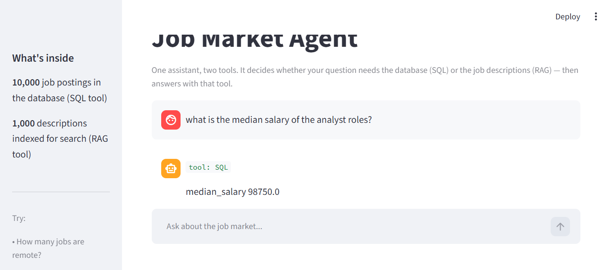

# Job Market Agent

One assistant, **three tools**. Ask a question in plain English — it decides
whether it needs the database (SQL), the job descriptions (RAG), or **both**.

**Live demo:** https://job-market-agent-v1.streamlit.app

## What it does

- 10,000 real job postings in SQLite — salary, location, seniority, company
- 1,000 job descriptions indexed for semantic search
- A router that picks the right tool per question, and shows you which it chose

## Examples

- "How many jobs are remote?"            -> SQL
- "Which 10 companies have the most postings?"  -> SQL
- "What skills do data analyst roles require?"  -> RAG
- "Do any jobs mention AI agents?"       -> RAG

## How it works

question -> router (SQL / RAG / chat) -> tool runs -> grounded answer

- **SQL tool**: the schema (with null-rates per column) goes to the LLM, which
  writes a query; we run it and show the result and the SQL.
- **RAG tool**: the question is embedded, matched against 1,000 job-description
  vectors by cosine similarity, and the top matches become the model's context.
- **Router**: one classification call decides which tool to use.

## Tech

Python, Streamlit, SQLite, fastembed, Groq

## Known data issues

- The source dataset mis-detects some pay periods. Salary rankings use only
  postings with `salary_period = 'year'` and read `salary_min`/`salary_max`
  directly, avoiding the inflated `*_annual` columns.
- `seniority` is 94% empty, so seniority questions are unreliable.
- Only 1,000 of the 10,000 descriptions are embedded for search (compute limits).
- The router picks one route per question; genuinely mixed questions can
  still land on the wrong one.
- Salary rankings ignore hourly/monthly postings (see Known data issues).
- The workplace_type model is ~71% accurate, so its filled values are
  estimates, not facts.

## Note on data

Built on the public "Job Postings with Salaries (October 2026)" dataset.
Descriptions belong to the employers that published them.

## Rate Limit Note

- The app retries with backoff on API rate limits (free tier: 8k tokens/min),
  and the evaluator paces its questions to stay under the cap.
